# Ultimate Optimizer

[](https://github.com/zaxar1231/ultra-optimizer-/actions/workflows/ci.yml)
[](https://github.com/zaxar1231/ultra-optimizer-/releases/latest)

[](LICENSE)

Обратимая оптимизация Windows 10 и 11 для любого ПК или ноутбука без переустановки системы.
Твики взяты из плейбука [AtlasOS](https://atlasos.net) v0.5.0 (только безопасные), к ним добавлены игровые настройки, профиль драйвера NVIDIA и установка полезных программ.

Перед каждым изменением скрипт записывает старое значение, поэтому **откат возвращает всё ровно как было**.

## Скачать

**[Последний релиз →](https://github.com/zaxar1231/ultra-optimizer-/releases/latest)**

| Файл | Что это |
|---|---|
| `UltimateOptimizer.exe` | Приложение в одном файле, все скрипты внутри. Просто запусти, дальше обновляется само. |
| `UltimateOptimizer-vX.Y.Z.zip` | Те же скрипты отдельными файлами + `.bat` + exe |
| `SHA256SUMS.txt` | Контрольные суммы |

Запуск: `UltimateOptimizer.exe` → «Да» в окне UAC.
Если SmartScreen предупреждает: «Подробнее» → «Выполнить в любом случае» (exe не подписан платным сертификатом; исходники и сборка открыты, см. [Actions](https://github.com/zaxar1231/ultra-optimizer-/actions)).

## Приложение

Окно в стиле **Material Design 3**: светлая и тёмная темы, навигационная панель, карточки, переключатели, диалоги. Ничего доустанавливать не нужно: приложение работает на .NET Framework, который встроен в Windows 10 и 11. Обновляется само.

<p align="center"></p>

| Тёмная тема | Светлая тема |
|---|---|
| 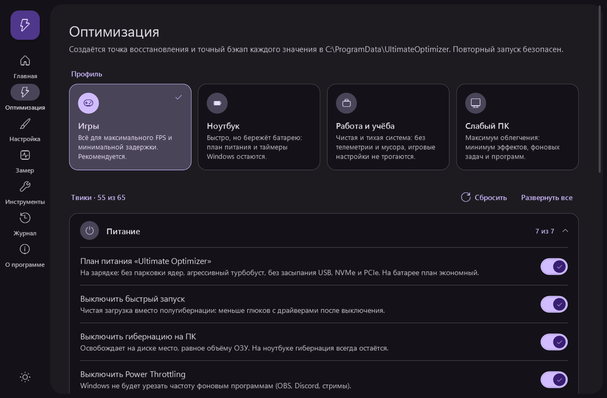 |  |
| **Оптимизация**: профили и переключатель у каждого из 65 твиков | |
| 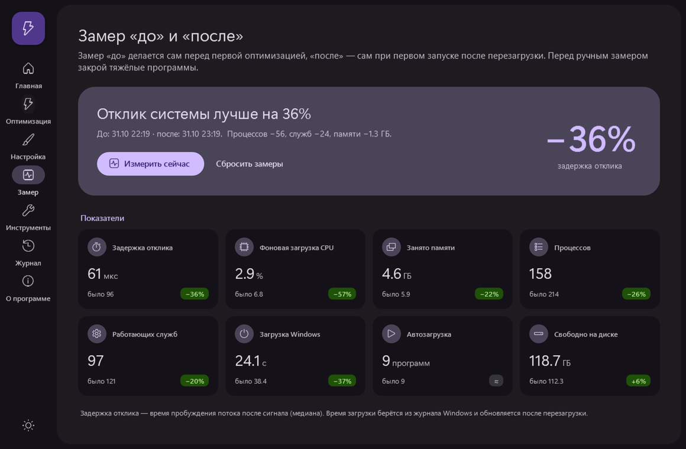 | 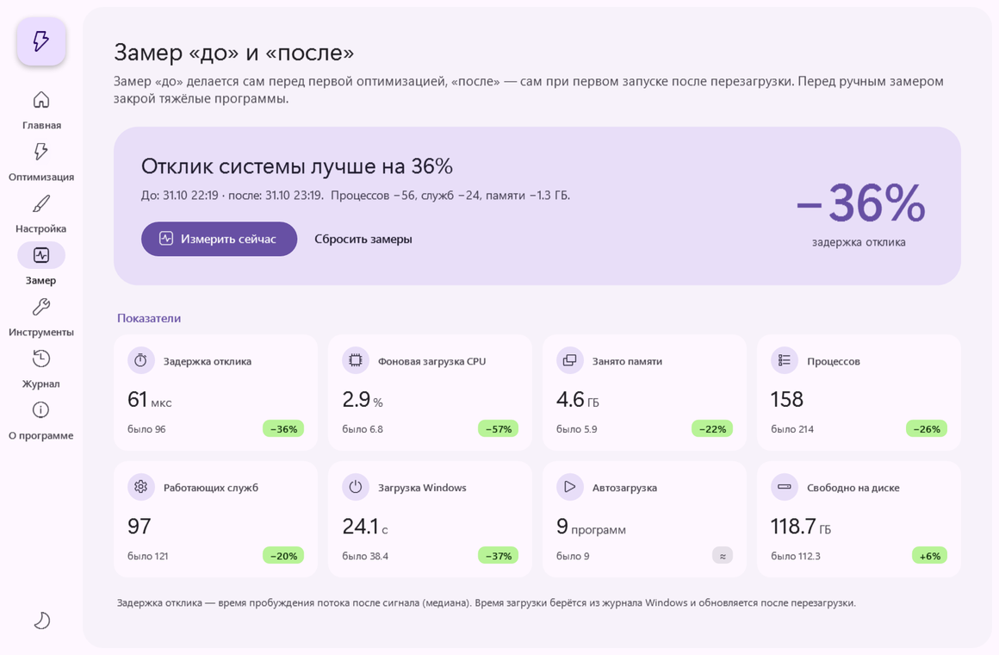 |
| **Замер «до» и «после»**: 8 показателей системы | |
| 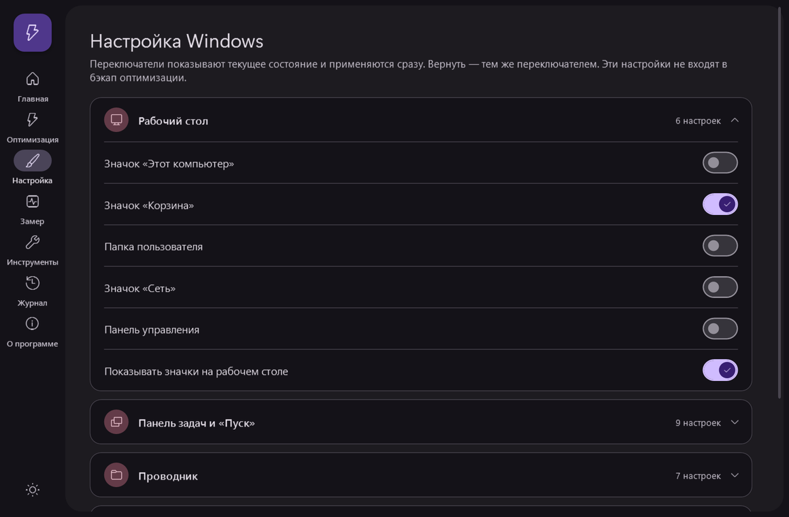 | 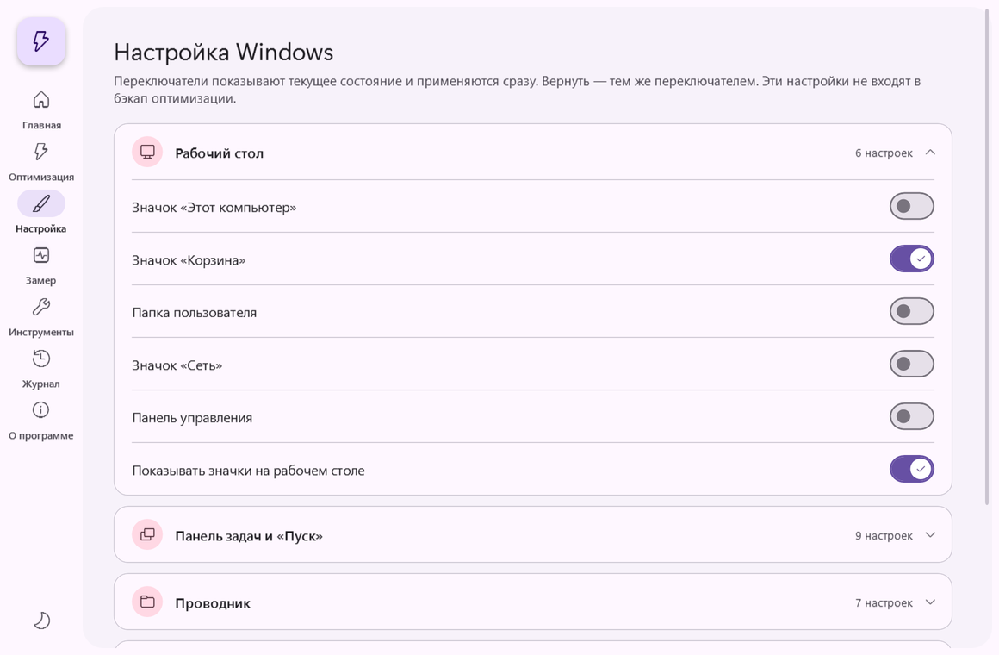 |
| **Настройка Windows**: ~40 переключателей, применяются сразу | |
|  | 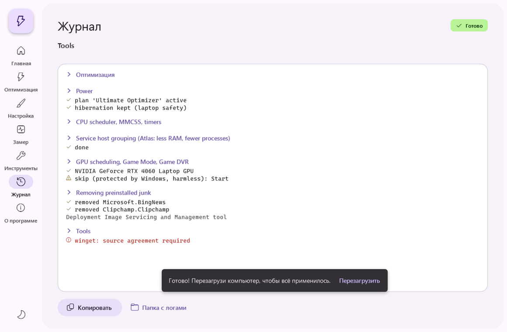 |
| **Журнал**: живой вывод скриптов с прогрессом | В конце предлагается перезагрузка |
|  | 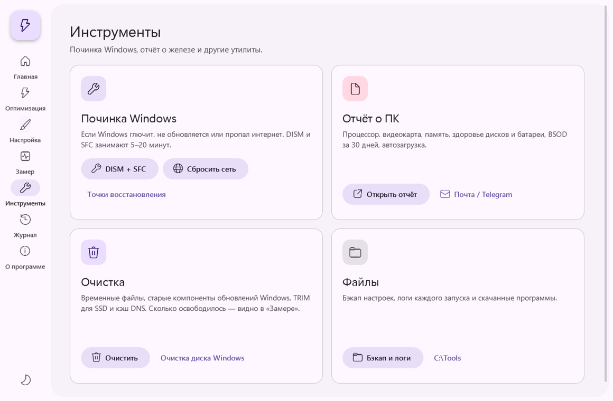 |
| **Инструменты**: починка Windows, отчёт о ПК, очистка | |
| 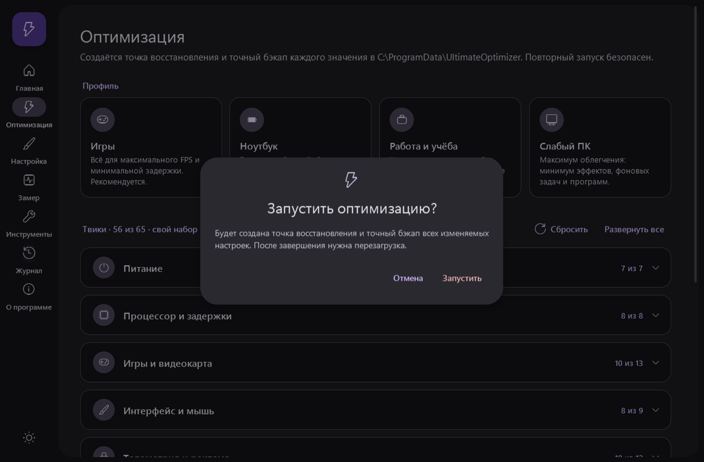 | 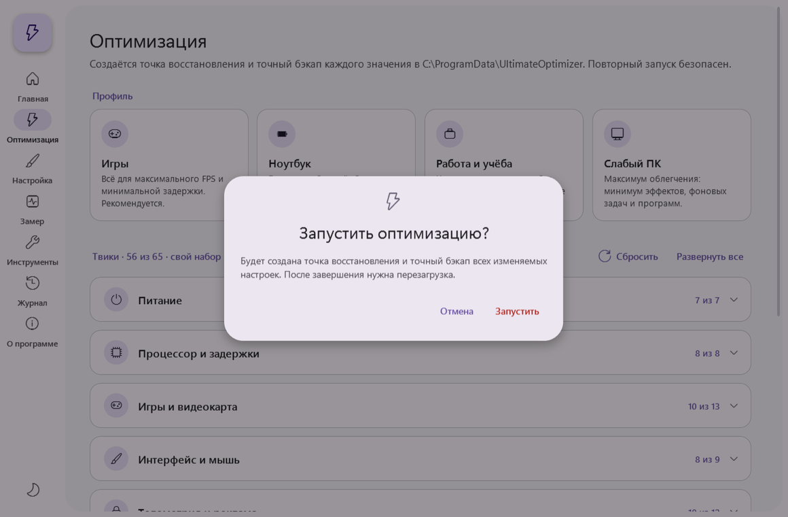 |
| Каждое действие подтверждается | |
| 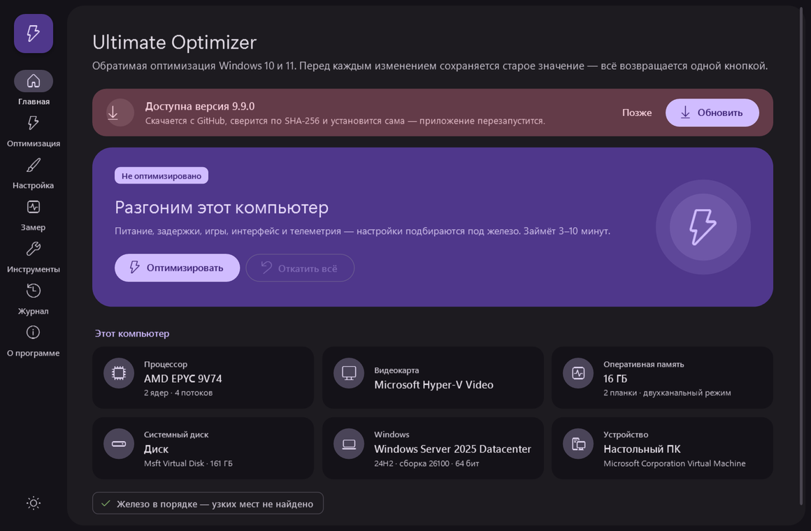 | 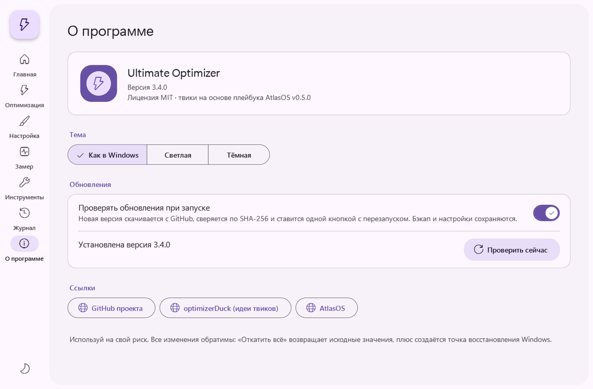 |
| **Автообновление**: баннер новой версии | Тема и настройки обновлений |

- **Главная**: железо ПК, статус оптимизации, подсказки по апгрейду.
- **Оптимизация**: профили «Игры», «Ноутбук», «Работа и учёба», «Слабый ПК» и 65 твиков в 9 группах. У каждого твика есть описание и свой переключатель, выбор запоминается.
- **Замер**: показатели системы «до» и «после» оптимизации.
- **Настройка Windows**: ~40 переключателей, применяются сразу.
- **Инструменты**: починка Windows (DISM + SFC, сброс сети, точки восстановления), отчёт о ПК, очистка, папки с бэкапом и логами.
- **Журнал**: живой вывод скриптов с прогрессом. Журнал можно скопировать.
- **О программе**: тема, автообновление, ссылки.

> Скриншоты рендерятся автоматически в CI (`UltimateOptimizer.exe --screenshots <папка>`) на Windows Server, поэтому в карточках железа видна виртуальная машина.

## Профили и отдельные твики

Каждое изменение — отдельный твик со своим ID, описанием и переключателем. Полный список лежит в [`launcher/ui/tweaks.json`](launcher/ui/tweaks.json).

| Профиль | Что делает |
|---|---|
| **Игры** | Всё для максимального FPS и минимальной задержки (по умолчанию) |
| **Ноутбук** | Без собственного плана питания, точных таймеров и отключения Power Throttling: батарея держит дольше |
| **Работа и учёба** | Без телеметрии и мусора, игровые настройки не трогаются |
| **Слабый ПК** | Максимум облегчения: ещё и без прозрачности, минимум программ |

Если поменять любой переключатель, набор станет «своим». Рискованные пункты (VBS, Spectre/Meltdown) по умолчанию выключены во всех профилях. Перед каждой сборкой проверяется, что ID в каталоге и в скрипте совпадают.

Тот же выбор доступен из командной строки:

```powershell
.\Ultimate-Optimizer.ps1 -Yes -Only power.plan,cpu.mmcss,gpu.gamedvr,ui.mouse
```

## Замер «до» и «после»

| Показатель | Как измеряется |
|---|---|
| Задержка отклика | Время пробуждения потока после сигнала (медиана и 99-й перцентиль, мкс). На него влияют таймеры, планировщик и прерывания. |
| Фоновая загрузка CPU | Средняя загрузка процессора за 2 секунды простоя |
| Занято памяти | Физическая ОЗУ |
| Процессов / работающих служб | Сколько всего запущено |
| Загрузка Windows | Длительность последней загрузки из журнала Diagnostics-Performance |
| Автозагрузка | Включённые записи Run и папки «Автозагрузка» |
| Свободно на диске | Системный диск |

Замер «до» делается сам перед первой оптимизацией, примерно за 5 секунд. Замер «после» делается сам при первом запуске приложения после перезагрузки. Разница показывается в процентах. Измерить можно и вручную, кнопкой «Измерить сейчас».

## Автообновление

При запуске приложение проверяет [последний релиз](https://github.com/zaxar1231/ultra-optimizer-/releases/latest). Если вышла новая версия, на главной появляется баннер.

1. Нажимаешь «Обновить».
2. Новый `UltimateOptimizer.exe` скачивается с GitHub.
3. SHA-256 сверяется с контрольной суммой релиза. Если не совпала, файл удаляется и ничего не ставится.
4. Exe подменяется, приложение перезапускается уже новой версией.

Бэкап, логи и настройки при этом сохраняются. Проверку можно выключить или запустить вручную в «О программе». Скачивать новые версии руками не нужно.

## Работает на любом ПК

- **Windows 10 (любая версия) и Windows 11**, x64 и ARM64. .NET Framework 4.6+ уже встроен в систему, приложение не просит ставить новый.
- **Нужные права запрашивает само** (UAC). Повторный запуск разворачивает уже открытое окно, а не открывает второе.
- **Если чего-то нет в системе, есть запасной вариант.** На Windows 10 нет шрифтов Segoe UI Variable и Fluent Icons — используются Segoe UI и MDL2. Без DWM-атрибутов заголовок окна остаётся стандартным. На старых видеокартах и в RDP включается программная отрисовка WPF.
- **Ошибки не роняют программу.** Сообщение показывается, подробности пишутся в `C:\ProgramData\UltimateOptimizer\crash.log`.
- **Сеть**: TLS 1.2 включается принудительно, используются системные настройки прокси.
- **Проверка в CI.** При каждом изменении на Windows проверяется синтаксис скриптов, PSScriptAnalyzer, совпадение каталога твиков со скриптом, сборка, рендер всех экранов, настоящий замер и сквозной тест автообновления.

## Что делает

Скрипт смотрит на железо и подстраивается под него:

- **Ноутбук**: на зарядке всё на максимум, на батарее экономнее. Гибернация остаётся.
- **HDD**: SysMain не отключается, на слабых ПК индексация переводится в ручной режим.
- **Мало ОЗУ**: отключается прозрачность.
- **NVIDIA / AMD / Intel**: отдельные настройки для каждой.

| Раздел | Изменения |
|---|---|
| Питание | Свой план «Ultimate Optimizer»: без парковки ядер, агрессивный турбобуст, без засыпания USB/NVMe/PCIe. Энергосбережение сетевой карты и быстрый запуск выключены. |
| Процессор и задержки | `Win32PrioritySeparation = 38`, MMCSS = 10, приоритет игр, dynamic tick выключен, FTH выключен, группировка svchost, NTFS без записи времени доступа |
| Игры | HAGS, игровой режим, Game DVR выключен, MSI-режим прерываний, настройки питания драйверов NVIDIA/AMD/Intel, USB без энергосбережения |
| Интерфейс и ввод | Быстрые визуальные эффекты, меню без задержек, без акселерации мыши, быстрый повтор клавиш, без залипания клавиш, чистый «Пуск», без фоновых приложений |
| Телеметрия | DiagTrack, AutoLogger, отчёты об ошибках, CEIP, PCA, реклама и «потребительские функции», Copilot, Recall, Click to Do, Bing в поиске, виджеты, задачи сбора данных; по желанию геолокация и «Поиск устройства» |
| Приложения | Удаляет предустановленный мусор (Teams, Clipchamp, Bing-приложения, Solitaire, TikTok, Candy Crush…). **Оставляет** Store, Xbox / Game Bar, Фото, Калькулятор, Камеру, Ножницы, Блокнот. |
| Программы (winget) | Visual C++ 2015+, DirectX, HWiNFO, Process Lasso, Autoruns, CrystalDiskInfo, 7-Zip, MSI Afterburner, G-Helper (ASUS) / Legion Toolkit (Lenovo), NVIDIA Profile Inspector |
| Профиль NVIDIA | Максимальная производительность, Low Latency On, V-Sync Off, Shader Cache без ограничения, Ansel Off |

Спросит отдельно (по умолчанию **нет**):
- выключить VBS / Memory Integrity: +5–15% FPS, но перестанут работать WSL2, Docker, Hyper-V;
- выключить защиту от Spectre/Meltdown: прирост в основном на процессорах до 2019 года.

Что из Atlas сознательно **не** взято, потому что это ломает ноутбуки или сеть: отключение устройств (SMBus и т.п.), NetBT и общего доступа к файлам, CFG (ломает античиты вроде Vanguard), автообновлений Windows.

## Настройка Windows

Отдельный экран с ~40 переключателями, которые применяются сразу и показывают текущее состояние системы. Вернуть настройку — тем же переключателем.

<p align="center"></p>

| Группа | Настройки |
|---|---|
| Рабочий стол | Значки «Этот компьютер», «Корзина», папка пользователя, «Сеть», «Панель управления», показ значков |
| Панель задач и «Пуск» | Значки по центру, группировка, поиск, «Представление задач», виджеты, «Завершить задачу» по правому клику, клик открывает последнее окно, секунды в часах, Bing в поиске |
| Проводник | Расширения файлов, скрытые файлы, открывать «Этот компьютер», классическое контекстное меню, флажки, компактный вид, реклама OneDrive |
| Система | Тёмная тема, уведомления, советы Windows, журнал буфера обмена, встряхивание окон, макеты прикрепления, NumLock при загрузке, подробные сообщения при входе, длинные пути, режим разработчика, часы в UTC, без Smart Name Resolution |
| Игры | Игровой режим, Xbox Game Bar, фоновая запись, оптимизация во весь экран, HAGS, акселерация мыши, индикатор DLSS (только NVIDIA) |

Настройки, которых нет в твоей системе, не показываются: например, пункты только для Windows 11 или для NVIDIA. Для изменений панели задач и Проводника есть кнопка «Перезапустить Проводник».

## Откуда твики

- **[AtlasOS](https://atlasos.net)** v0.5.0 — основа: питание, планировщик, телеметрия, службы, приложения.
- **[optimizerDuck](https://github.com/itsfatduck/optimizerDuck)** (GPL-3.0) — идеи твиков:
  - питание драйверов NVIDIA, AMD и Intel, энергосбережение USB, MMCSS без «ленивого» режима;
  - клавиатура и залипание клавиш, чистый «Пуск», локальный поиск;
  - AutoLogger, геолокация, «Поиск устройства», долгая пауза обновлений, расширенная приватность;
  - набор настроек экрана «Настройка Windows».
  
  Код optimizerDuck не копировался: всё реализовано заново в `Ultimate-Optimizer.ps1` и `launcher/` и проходит через общий бэкап и откат. Сам optimizerDuck больше не скачивается.
- **[Chris Titus WinUtil](https://github.com/ChrisTitusTech/winutil)** (MIT) — список служб для рискованного пункта «Службы в ручной запуск».

## Запуск скриптов вручную

```powershell
# PowerShell от имени администратора, в папке со скриптами
Set-ExecutionPolicy -Scope Process Bypass -Force
.\Ultimate-Optimizer.ps1            # с вопросами
.\Ultimate-Optimizer.ps1 -Yes       # без вопросов (рискованное не трогает)
.\Ultimate-Optimizer.ps1 -NoApps    # без скачивания программ
.\Ultimate-Optimizer.ps1 -Yes -Only cpu.mmcss,ui.mouse   # только выбранные твики
.\Ultimate-Optimizer.ps1 -Undo      # откатить всё
```

`UltimateOptimizer.exe` с ключами (`UltimateOptimizer.exe -Yes`) запускает скрипт в консоли без окна приложения.

## Откат и безопасность

- Бэкап хранится в `C:\ProgramData\UltimateOptimizer\backup.json`: значения реестра, службы, задачи, план питания, сетевая карта, удалённые приложения, профиль NVIDIA.
- Повторный запуск бэкап не перезаписывает, в нём всегда лежат самые первые, заводские значения.
- Дополнительно создаётся точка восстановления «Before Ultimate-Optimizer».
- Лог каждого запуска: `C:\ProgramData\UltimateOptimizer\log_*.txt`.

Если что-то пошло не так:
1. Нажми «Откатить всё» (на главной или в разделе «Оптимизация») и перезагрузись.
2. Если Windows не загружается: 3 раза подряд выключи ПК кнопкой во время загрузки → «Дополнительные параметры» → «Восстановление системы» → точка «Before Ultimate-Optimizer».
3. Если сеть пропала: «Инструменты» → «Сбросить сеть».

## Отчёт о ПК

`PC-Info-Mail.ps1` собирает HTML-отчёт: процессор, видеокарта, ОЗУ, SMART дисков, батарея, температуры, BSOD за 30 дней, автозагрузка. Отчёт уходит на почту (Gmail, нужен [пароль приложения](https://myaccount.google.com/apppasswords)) или в Telegram-бота.
При первом запуске скрипт спрашивает адреса и запоминает их. Пароль хранится зашифрованным (DPAPI), расшифровать его может только текущий пользователь Windows.

```powershell
.\PC-Info-Mail.ps1 -NoMail            # только открыть отчёт
.\PC-Info-Mail.ps1 -Method Telegram   # отправить в Telegram
.\PC-Info-Mail.ps1 -ResetPassword     # заново ввести адреса и пароль
```

## Требования

- Windows 10 (1507+) или Windows 11, x64 или ARM64. Windows 7 и 8.1 не поддерживаются.
- Права администратора.
- Для установки программ нужен winget («Установщик приложений» из Microsoft Store).

## Сборка

```powershell
powershell -ExecutionPolicy Bypass -File build.ps1        # Windows: csc.exe из .NET Framework 4
pwsh ./build.ps1 -RefDir <net48 reference assemblies>     # Linux: mono-mcs + NuGet microsoft.netframework.referenceassemblies.net48
```

Результат появляется в `dist/`. Релиз собирается автоматически, когда пушится тег `vX.Y.Z`, совпадающий с файлом `VERSION`.

```
scripts/     PowerShell-скрипты, .bat, профили NVIDIA, README.txt для пользователя
launcher/    исходник приложения: WPF + Material Design 3 (C#, .NET Framework 4.8)
  ui/        разметка XAML, стили компонентов MD3, иконка
docs/        скриншоты (рендерятся в CI: UltimateOptimizer.exe --screenshots <папка>)
build.ps1    сборка exe + zip + SHA256SUMS
.github/     CI (проверка PSScriptAnalyzer + сборка) и релизы
```

## Отказ от ответственности

Используй на свой риск. Все изменения обратимы, но перед запуском всё равно стоит сохранить важные данные.

[MIT](LICENSE)
