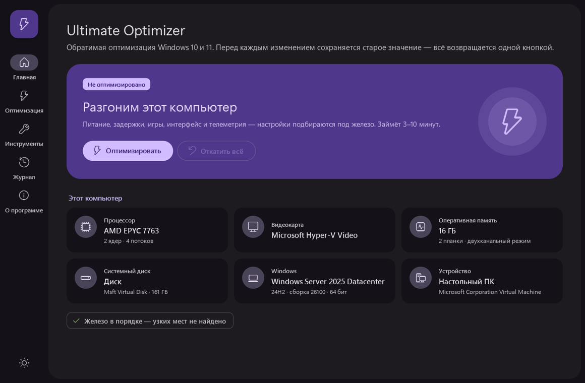
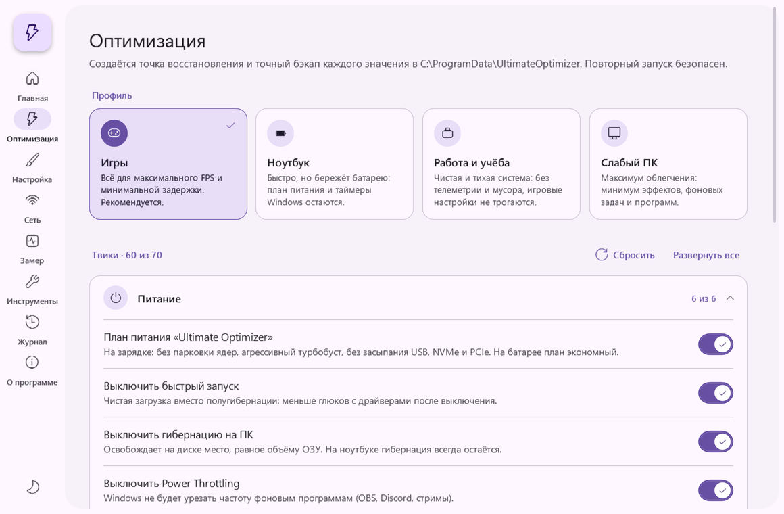
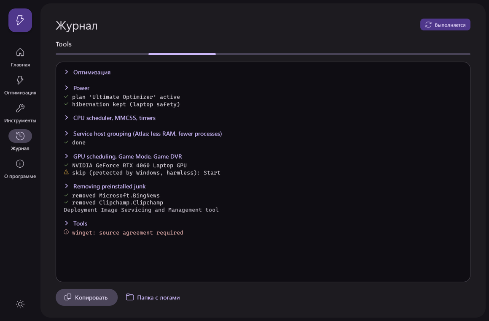
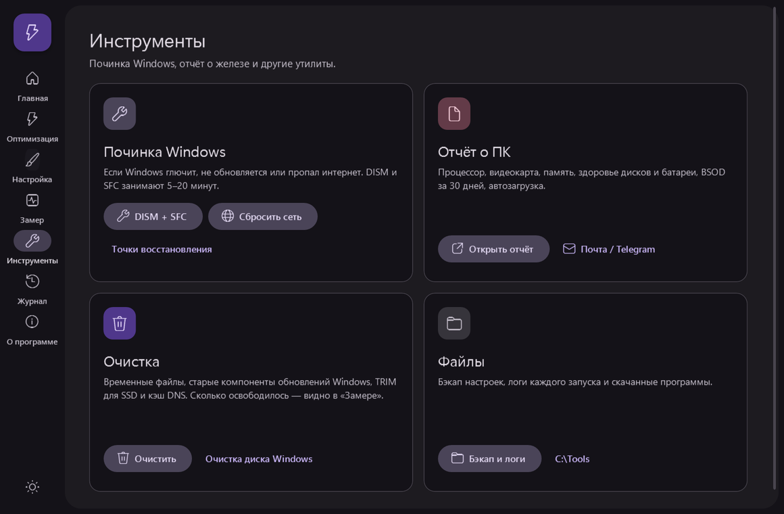
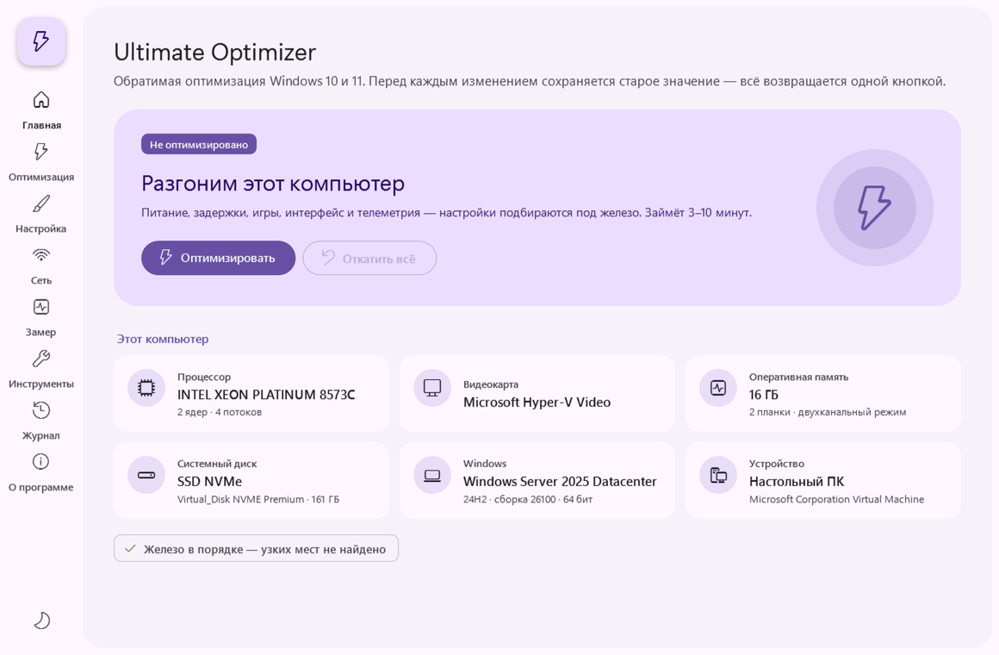

# Ultimate Optimizer

[](https://github.com/zaxar1231/ultra-optimizer-/actions/workflows/ci.yml)
[](https://github.com/zaxar1231/ultra-optimizer-/releases/latest)

[](LICENSE)

Обратимая оптимизация Windows 10 и 11 для любого ПК или ноутбука без переустановки системы.
Твики взяты из плейбука [AtlasOS](https://atlasos.net) v0.5.0 (только безопасные), к ним добавлены игровые настройки, профиль драйвера NVIDIA и установка полезных программ.

Перед каждым изменением скрипт записывает старое значение, поэтому **откат возвращает всё ровно как было**.

## Скачать

**[Последний релиз →](https://github.com/zaxar1231/ultra-optimizer-/releases/latest)**

| Файл | Что это |
|---|---|
| `UltimateOptimizer.exe` | Приложение в одном файле, все скрипты внутри. Просто запусти. |
| `UltimateOptimizer-vX.Y.Z.zip` | Те же скрипты отдельными файлами + `.bat` + exe |
| `SHA256SUMS.txt` | Контрольные суммы |

Запуск: `UltimateOptimizer.exe` → «Да» в окне UAC.
Если SmartScreen предупреждает: «Подробнее» → «Выполнить в любом случае» (exe не подписан платным сертификатом; исходники и сборка открыты, см. [Actions](https://github.com/zaxar1231/ultra-optimizer-/actions)).

## Приложение

Окно в стиле **Material Design 3**: светлая и тёмная темы, навигационная панель, карточки, переключатели. Ничего доустанавливать не нужно, приложение работает на .NET Framework 4.8, который встроен в Windows 10 и 11.

<p align="center"></p>

| | |
|---|---|
|  |  |
|  |  |

- **Главная**: железо ПК, статус оптимизации, подсказки по апгрейду.
- **Оптимизация**: переключатели опций (программы, optimizerDuck, рискованные пункты) и запуск.
- **Инструменты**: починка Windows (DISM + SFC, сброс сети, точки восстановления), отчёт о ПК, optimizerDuck, папки с бэкапом и логами.
- **Журнал**: живой вывод скриптов с прогрессом. Журнал можно скопировать.
- **О программе**: выбор темы и ссылки.

## Что делает

Скрипт смотрит на железо и подстраивается под него:

- **Ноутбук**: на зарядке всё на максимум, на батарее экономнее. Гибернация остаётся.
- **HDD**: SysMain не отключается, на слабых ПК индексация переводится в ручной режим.
- **Мало ОЗУ**: отключается прозрачность.
- **NVIDIA / AMD / Intel**: отдельные настройки для каждой.

| Раздел | Изменения |
|---|---|
| Питание | Свой план «Ultimate Optimizer»: без парковки ядер, агрессивный турбобуст, без засыпания USB/NVMe/PCIe. Энергосбережение сетевой карты и быстрый запуск выключены. |
| Процессор и задержки | `Win32PrioritySeparation = 38`, MMCSS = 10, приоритет игр, dynamic tick выключен, FTH выключен, группировка svchost, NTFS без записи времени доступа |
| Игры | HAGS, игровой режим, Game DVR выключен, MSI-режим прерываний для видеокарты, ULPS у AMD выключен |
| Интерфейс | Быстрые визуальные эффекты, меню без задержек, без акселерации мыши, без фоновых приложений |
| Телеметрия | DiagTrack, отчёты об ошибках, CEIP, PCA, реклама, Copilot, Recall, виджеты, задачи сбора данных |
| Приложения | Удаляет предустановленный мусор (Teams, Clipchamp, Bing-приложения, Solitaire, TikTok, Candy Crush…). **Оставляет** Store, Xbox / Game Bar, Фото, Калькулятор, Камеру, Ножницы, Блокнот. |
| Программы (winget) | Visual C++ 2015+, DirectX, HWiNFO, Process Lasso, Autoruns, CrystalDiskInfo, 7-Zip, MSI Afterburner, G-Helper (ASUS) / Legion Toolkit (Lenovo), NVIDIA Profile Inspector, **optimizerDuck** |
| Профиль NVIDIA | Максимальная производительность, Low Latency On, V-Sync Off, Shader Cache без ограничения, Ansel Off |

Спросит отдельно (по умолчанию **нет**):
- выключить VBS / Memory Integrity: +5–15% FPS, но перестанут работать WSL2, Docker, Hyper-V;
- выключить защиту от Spectre/Meltdown: прирост в основном на процессорах до 2019 года.

Что из Atlas сознательно **не** взято, потому что это ломает ноутбуки или сеть: отключение устройств (SMBus и т.п.), NetBT и общего доступа к файлам, CFG (ломает античиты вроде Vanguard), автообновлений Windows.

## optimizerDuck

Пункт меню 6 или `5-Get-OptimizerDuck.bat` скачивает последний релиз
[optimizerDuck](https://github.com/itsfatduck/optimizerDuck): open-source оптимизатор с графическим интерфейсом от itsfatduck, лицензия GPL-3.0.

- Сборка выбирается под процессор: x64 или ARM64.
- SHA-256 сверяется с контрольной суммой, которую публикует GitHub.
- Файл сохраняется в `C:\Tools\optimizerDuck`, старые версии удаляются.
- В этот репозиторий optimizerDuck **не** входит, файл всегда скачивается с официальной страницы релизов.

```powershell
.\Get-OptimizerDuck.ps1            # скачать и запустить
.\Get-OptimizerDuck.ps1 -NoLaunch  # только скачать
.\Get-OptimizerDuck.ps1 -Force     # скачать заново
```

## Запуск скриптов вручную

```powershell
# PowerShell от имени администратора, в папке со скриптами
Set-ExecutionPolicy -Scope Process Bypass -Force
.\Ultimate-Optimizer.ps1            # с вопросами
.\Ultimate-Optimizer.ps1 -Yes       # без вопросов (рискованное не трогает)
.\Ultimate-Optimizer.ps1 -NoApps    # без скачивания программ
.\Ultimate-Optimizer.ps1 -NoDuck    # без optimizerDuck
.\Ultimate-Optimizer.ps1 -Undo      # откатить всё
```

`UltimateOptimizer.exe` с ключами (`UltimateOptimizer.exe -Yes`) запускает скрипт в консоли без окна приложения.

## Откат и безопасность

- Бэкап хранится в `C:\ProgramData\UltimateOptimizer\backup.json`: значения реестра, службы, задачи, план питания, сетевая карта, удалённые приложения, профиль NVIDIA.
- Повторный запуск бэкап не перезаписывает, в нём всегда лежат самые первые, заводские значения.
- Дополнительно создаётся точка восстановления «Before Ultimate-Optimizer».
- Лог каждого запуска: `C:\ProgramData\UltimateOptimizer\log_*.txt`.

Если что-то пошло не так:
1. Нажми «Откатить всё» (на главной или в разделе «Оптимизация») и перезагрузись.
2. Если Windows не загружается: 3 раза подряд выключи ПК кнопкой во время загрузки → «Дополнительные параметры» → «Восстановление системы» → точка «Before Ultimate-Optimizer».
3. Если сеть пропала: «Инструменты» → «Сбросить сеть».

## Отчёт о ПК

`PC-Info-Mail.ps1` собирает HTML-отчёт: процессор, видеокарта, ОЗУ, SMART дисков, батарея, температуры, BSOD за 30 дней, автозагрузка. Отчёт уходит на почту (Gmail, нужен [пароль приложения](https://myaccount.google.com/apppasswords)) или в Telegram-бота.
При первом запуске скрипт спрашивает адреса и запоминает их. Пароль хранится зашифрованным (DPAPI), расшифровать его может только текущий пользователь Windows.

```powershell
.\PC-Info-Mail.ps1 -NoMail            # только открыть отчёт
.\PC-Info-Mail.ps1 -Method Telegram   # отправить в Telegram
.\PC-Info-Mail.ps1 -ResetPassword     # заново ввести адреса и пароль
```

## Требования

- Windows 10 (1507+) или Windows 11, x64 или ARM64. Windows 7 и 8.1 не поддерживаются.
- Права администратора.
- Для установки программ нужен winget («Установщик приложений» из Microsoft Store).

## Сборка

```powershell
powershell -ExecutionPolicy Bypass -File build.ps1        # Windows: csc.exe из .NET Framework 4
pwsh ./build.ps1 -RefDir <net48 reference assemblies>     # Linux: mono-mcs + NuGet microsoft.netframework.referenceassemblies.net48
```

Результат появляется в `dist/`. Релиз собирается автоматически, когда пушится тег `vX.Y.Z`, совпадающий с файлом `VERSION`.

```
scripts/     PowerShell-скрипты, .bat, профили NVIDIA, README.txt для пользователя
launcher/    исходник приложения: WPF + Material Design 3 (C#, .NET Framework 4.8)
  ui/        разметка XAML, стили компонентов MD3, иконка
docs/        скриншоты (рендерятся в CI: UltimateOptimizer.exe --screenshots <папка>)
build.ps1    сборка exe + zip + SHA256SUMS
.github/     CI (проверка PSScriptAnalyzer + сборка) и релизы
```

## Отказ от ответственности

Используй на свой риск. Все изменения обратимы, но перед запуском всё равно стоит сохранить важные данные.

[MIT](LICENSE) · optimizerDuck распространяется под собственной лицензией GPL-3.0.
